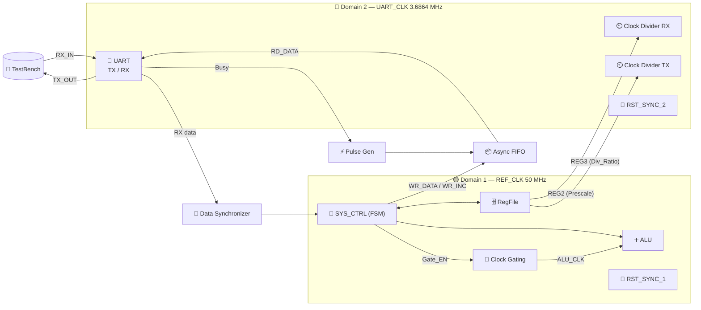
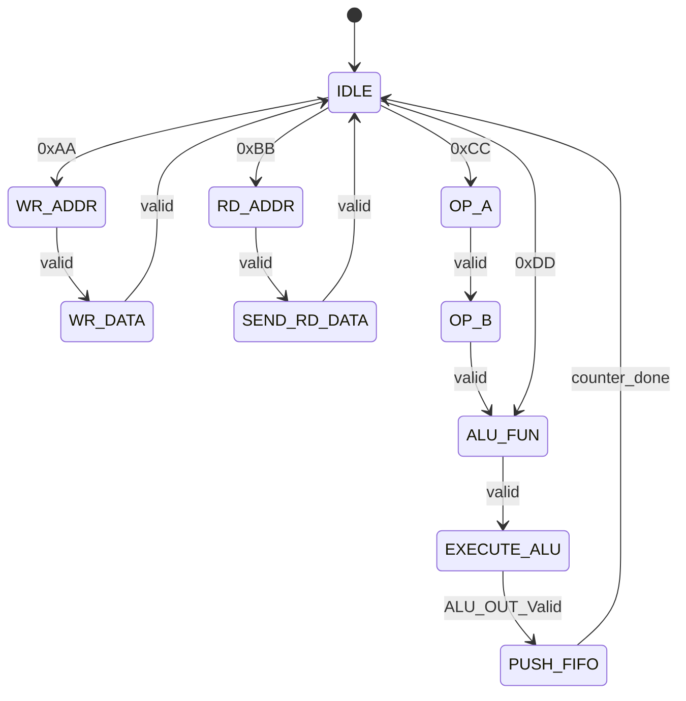

<div align="center">

# ⚡ RTL to GDS ASIC Flow Implementation
### 🔋 Power-Configurable Multi-Clock Digital System


**👨‍💻 Designed by Shahd Mahmoud**

<!-- 🖼️ Replace the path below with your cover image -->
<!--  -->

</div>

---

## 📑 Table of Contents

- [🎯 Overview](#-overview)
- [✨ Key Features](#-key-features)
- [🏗️ System Architecture](#️-system-architecture)
- [🧩 RTL Sub-Modules](#-rtl-sub-modules)
- [🧪 Verification & Testbench](#-verification--testbench)
- [🛠️ Synthesis & Timing](#️-synthesis--timing)
- [🧹 SpyGlass Lint & CDC](#-spyglass-lint--cdc)
- [✅ Formal Verification (LEC)](#-formal-verification-lec)
- [🔍 Design for Testability (DFT)](#-design-for-testability-dft)
- [🧱 Backend: Place & Route](#-backend-place--route)
- [⏱️ Gate-Level Simulation](#️-gate-level-simulation)
- [🧰 Tools Used](#-tools-used)
- [📁 Repository Structure](#-repository-structure)
- [🏁 Conclusion](#-conclusion)

---

## 🎯 Overview

This project presents the **complete RTL-to-GDS design flow** of a command-driven, multi-module digital processing system written in **Verilog HDL**.

The system works as a dedicated hardware processing unit that:

1. 📥 Receives **asynchronous serial commands** from an external master via **UART**
2. 🧠 Decodes them and processes through an **ALU** or **Register File**
3. 📤 Sends the result back through a **synchronized UART transmission channel**

---

## ✨ Key Features

| 🔹 Feature | 📝 Description |
|---|---|
| 🕐 **Dual-Clock Domains** | `REF_CLK` = **50 MHz** and `UART_CLK` = **3.6864 MHz** with safe CDC |
| ➕ **ALU** | Arithmetic, logical, comparison and shift operations |
| 🗄️ **Register File** | 16 × 8-bit registers, with reserved config/operand registers |
| 📡 **UART** | TX + RX with parity (even/odd), prescaler and error detection |
| 🔋 **Power Management** | Clock gating for the ALU (ICG cell) |
| 🔄 **Synchronization** | Reset synchronizers, data synchronizer, pulse generator, Async FIFO |
| 🛡️ **Robust RX** | Oversampling, parity / stop-bit / start-glitch detection |

---

## 🏗️ System Architecture

<!-- 🖼️  -->



### 🟡 Clock Domain 1 — `REF_CLK` (50 MHz)
- 🗄️ **RegFile** — storage and system configuration
- ➕ **ALU** — executes math/logic instructions
- 🔋 **Clock Gating** — controls `ALU_CLK` to save dynamic power
- 🧠 **SYS_CTRL** — central FSM (command decode, register access, data flow)

### 🔵 Clock Domain 2 — `UART_CLK` (3.6864 MHz)
- 📡 **UART_TX / UART_RX** — serial ↔ parallel conversion
- ⏲️ **Clock Dividers** — generate TX/RX clocks from the configured ratios
- 🔄 **Pulse Gen / Data Sync / Async FIFO** — safe bridging between both domains

---

## 🧩 RTL Sub-Modules

### 🗄️ 1. Register File
Works on `REF_CLK`, active-low async reset.

| 📍 Address | 🏷️ Register | 🎯 Purpose |
|:---:|---|---|
| `0x0` | `REG0` | ALU Operand **A** |
| `0x1` | `REG1` | ALU Operand **B** |
| `0x2` | `REG2` | UART config (Parity Enable = 1, Parity Type = 0, Prescale = 32) |
| `0x3` | `REG3` | Clock divider ratio (default = 32) |
| `0x4+` | General | General-purpose read/write storage |

- ✍️ **Write:** `WrEn` (exclusive with `RdEn`)
- 📖 **Read:** `RdEn` → `RdData` + `RdData_Valid` for one cycle

---

### ➕ 2. Arithmetic Logic Unit (ALU)
Runs on the **gated clock** `CLK_alu`, 8-bit inputs → **16-bit** output, registered output + valid flag.

| 🔢 Code | ⚙️ Operation | 🏷️ Category |
|:---:|---|---|
| `0000` | `A + B` | ➕ Arithmetic |
| `0001` | `A - B` | ➕ Arithmetic |
| `0010` | `A * B` | ➕ Arithmetic |
| `0011` | `A / B` (zero-protected) | ➕ Arithmetic |
| `0100` – `1001` | AND, OR, NAND, NOR, XOR, XNOR | 🔣 Logical |
| `1010` | `A == B` → 1 | ⚖️ Compare |
| `1011` | `A > B` → 2 | ⚖️ Compare |
| `1100` | `A < B` → 3 | ⚖️ Compare |
| `1101` | `A >> 1` | ↔️ Shift |
| `1110` | `A << 1` | ↔️ Shift |
| `1111` | NOP → 0 | 💤 Default |

---

### 🔋 3. Clock Gating Unit
- 🏭 **ASIC flow:** uses the technology ICG cell `TLATNCAX12M` (negative-level latch) → **glitch-free** gated clock
- 💻 **RTL model:** transparent latch (active when clock is low) + AND gate
- Controlled by `CLKG_EN` from the system controller

---

### 🧠 4. System Controller (FSM)

| 🔑 Command | 📟 Byte | 🎯 Action |
|---|:---:|---|
| ✍️ Register Write | `0xAA` | `WR_ADDR` → `WR_DATA` |
| 📖 Register Read | `0xBB` | Read address → send data to FIFO |
| ➕ ALU Op (with operands) | `0xCC` | `OP_A` → `OP_B` → `FUN` → Execute → Push FIFO |
| 💤 ALU NOP (no operands) | `0xDD` | `FUN` → Execute → Push FIFO |



📦 **16 → 8 bit serialization:** the `PUSH_FIFO` state pushes the **high byte** `[15:8]` first, then the **low byte** `[7:0]`. `FIFO_FULL` pauses transmission to avoid overflow.

---

### ⏲️ 5. Clock Divider
- Configurable ratio from `REG3`, with enable bypass
- 🎯 **50% duty cycle** for odd ratios using posedge (`q1`) + negedge (`q2`) flip-flops with `q1 | q2`
- Active-low async reset from `RST_SYNC_2`

---

### 📡 6. UART Subsystem

<table>
<tr>
<th>📤 UART_TX</th>
<th>📥 UART_RX</th>
</tr>
<tr>
<td valign="top">

- 🧠 FSM: Idle, Start, Data, Parity, Stop
- ➗ Parity calculator (even/odd)
- 🔀 Output MUX (start/data/parity/stop)
- 🔁 Serializer

</td>
<td valign="top">

- 🧠 FSM (3-bit **Gray code**: IDLE `000`, START `001`, DATA `011`, PARITY `010`, STOP `110`)
- 🔬 Oversampling data sampler (center at Prescale/2)
- 🔁 Deserializer → 8-bit parallel
- ❌ Parity / Stop / Start-glitch checkers

</td>
</tr>
</table>

---

### ⚡ 7. Pulse Generator
Converts a level signal into a **single-cycle pulse** (rising-edge detector):

```verilog
pulse_sig = lvl_sig_ff && (~pulse_flop);
```

### 🔁 8. Reset Synchronizer (`RST_SYNC`)
- ⚡ **Asynchronous assertion** — immediate reset
- 🕐 **Synchronous de-assertion** — through `NUM_STAGES` flip-flops (default 2) to prevent metastability

### 🔄 9. Data Synchronizer (`Data_SYNC`)
- Multi-stage synchronizer for `BUS_EN`
- Pulse generator on the synchronized enable
- Latches the bus (`BUS_WIDTH` = 8) **only when enable pulse arrives** → no race conditions

### 📦 10. Asynchronous FIFO
- 🔢 **Gray-code** pointers
- 🔁 Two dual-flop synchronizers (`BIT_SYNC`: w2r and r2w)
- 🟥 `FIFO_WR` (Full) · 🟩 `FIFO_RD` (Empty) · 🧱 `FIFO_MEM_CNTRL` (dual-port memory)

---

## 🧪 Verification & Testbench

A **self-checking testbench** (`SYS_TOP_TB`) emulates the UART master, parity configuration, register transactions and ALU execution.

| 🧱 Item | 📝 Detail |
|---|---|
| 🕐 `REF_CLK_tb` | 50 MHz (20 ns period) |
| 🕐 `UART_CLK_tb` | Baud-rate UART clock |
| ⏱️ Bit period | `BIT_PERIOD = PRESCALE * BIT_TIME` (Prescale = 32) |
| 🛠️ Tasks | `write_reg`, `read_reg_and_check`, `uart_send_byte`, `uart_receive_byte` |

### 📋 Test Phases

| 🔢 Phase | 🎯 Scenario | ✅ Result |
|:---:|---|:---:|
| **1** | ⚙️ Configuration — parity enable (`0x02 ← 0x81`) and `0x03 ← 0x20` | ✅ PASS |
| **2** | 🗄️ Register write/read — `0x55`, `0xAA`, `0x3F` to addr `0x04`, `0x05`, `0x06` | ✅ PASS |
| **3** | ➕ ALU ops with 16-bit result captured over 2 UART bytes | ✅ PASS |

### 🧮 ALU Test Vectors

| A | B | Function | Expected | Result |
|:---:|:---:|:---:|:---:|:---:|
| `0x10` | `0x05` | ADD | `0x0015` | ✅ |
| `0x20` | `0x05` | SUB | `0x001B` | ✅ |
| `0xF0` | `0x0F` | MUL | `0x0E10` | ✅ |

```text
ALL TESTS PASSED SUCCESSFULLY! No errors detected.
```

<!-- 🖼️  -->
<!-- 🖼️  -->

---

## 🛠️ Synthesis & Timing

Synthesized with **Synopsys Design Compiler** targeting `scmetro_tsmc_cl013g_rvt_ss_1p08v_125c` (TSMC 130nm).

### 📐 Area (Pre-DFT)

| 📊 Metric | 🔢 Value |
|---|---:|
| Ports | 791 |
| Nets | 3092 |
| Total Cells | **2264** |
| Combinational Cells | 1760 |
| Sequential Cells | 466 |
| Buffers / Inverters | 285 |
| Combinational Area | 14265.13 |
| Non-combinational Area | 11565.78 |
| 🏆 **Total Cell Area** | **25830.92** |

### ⏱️ Static Timing Analysis

| 🔍 Item | 📝 Value |
|---|---|
| 🚦 Start point | `reg_file/Reg_File_reg[1][7]` (clk: `REF_CLK`) |
| 🏁 End point | `alu/ALU_OUT_reg[0]` (clk: `ALU_CLK`) |
| 📏 Path type | max (setup) |
| ⏳ Data required time | 19.63 ns |
| ⏳ Data arrival time | 15.53 ns |
| 🟢 **Slack (MET)** | **+4.10 ns** |

> [!TIP]
> ✅ `This design has no violated constraints.`

### 🔋 Power (Pre-DFT)

| ⚡ Switching | 🔌 Internal | 💧 Leakage | 🏆 Total |
|:---:|:---:|:---:|:---:|
| 7.43e-03 | 0.260 | 1.44e+07 | **0.282** |

---

## 🧹 SpyGlass Lint & CDC

Static lint and CDC analysis done with **Synopsys SpyGlass**. Reviewed items were waived with documented justifications.

| 📜 Rule | 🎯 Purpose | 💬 Justification |
|---|---|---|
| `STARC05-1.4.3.4` | Clock used as non-clock input (`Clk_div_50`, `CLK_DIV_TX.q1`) | Divider outputs intentionally routed into logic |
| `ReportIgnoredOverlappingRules` | Report cleanup | Filters redundant overlapping checks |
| `Ac_conv04` | Async conversion / sync check | Proper synchronizer chains implemented |
| `Ac_cdc01a`, `Ac_datahold01a` | CDC & data-hold | Verified as safe after review |
| `Setup_port01`, `Clock_check04` | Port setup & clock checks | Handled externally / verified through STA |

---

## ✅ Formal Verification (LEC)

**Synopsys Formality** compared the golden RTL against the implementation netlists.

| 🔬 Stage | ✅ Passing | ❌ Failing | 📝 Notes |
|---|:---:|:---:|---|
| 🔍 **Post-DFT** | **447** | **0** | `Verification SUCCEEDED` |
| 🧱 **Post-PNR** | **422** | **0** | 5 don't-verify, 24 unread, 1 constant reg |

---

## 🔍 Design for Testability (DFT)

Sequential elements replaced with **scan flip-flops** forming structured scan chains (targets stuck-at and transition faults).

### 📈 Impact of DFT Insertion

| 📊 Metric | 🔵 Pre-DFT | 🟣 Post-DFT | 📉 Change |
|---|---:|---:|:---:|
| Total Cells | 2264 | 3111 | ⬆️ +847 |
| Combinational Cells | 1760 | 2601 | ⬆️ |
| Sequential Cells | 466 | 466 | ➖ |
| Buffers / Inverters | 285 | 1107 | ⬆️ |
| Combinational Area | 14265.13 | 21284.15 | ⬆️ |
| Non-combinational Area | 11565.78 | 14715.81 | ⬆️ |
|  **Total Cell Area** | **25830.92** | **35999.96** | **⬆️ ≈ +39.4%** |
| ⚡ Switching Power | 7.43e-03 | 0.200 | ⬆️ |
| 🔌 Internal Power | 0.260 | 7.32e-02 | ⬇️ |
| 💧 Leakage Power | 1.44e+07 | 2.19e+07 | ⬆️ |
| 🔋 **Total Power** | **0.282** | **0.296** | ⬆️ ≈ +5% |

> [!NOTE]
> The structural DFT insertion was verified with Formality (see [Formal Verification](#-formal-verification-lec)) — zero functional corruption.

---

## 🧱 Backend: Place & Route

Flow: **Floorplan → Placement → CTS → Global/Detailed Routing**

### 📐 Floorplan

| 📏 Parameter | 🔢 Value |
|---|---:|
| Core Size (W × H) | **227.96 × 206.64 µm** |
| Die Size (W × H) | **240.11 × 218.79 µm** |
| Aspect Ratio (H/W) | 0.906 (near-square) |
| Core Utilization | 1.0 |
| Core-to-IO Margins | ~6.0 – 6.15 µm |
| Origin | Lower-left corner |

<!-- 🖼️  -->
<!-- 🖼️  -->

---

## ⏱️ Gate-Level Simulation

- 🧪 GLS performed on the **final routed netlist** with back-annotated **SDF**
- ✅ All test vectors passed
- ⚡ **PrimeTime** power analysis used for post-layout power correlation against pre-layout estimates

---

## 🧰 Tools Used

| 🛠️ Stage | 🧰 Tool |
|---|---|
|  RTL Design | Verilog HDL |
|  Simulation | ModelSim |
|  RTL Schematics | Xilinx Vivado |
|  Lint / CDC | Synopsys SpyGlass |
|  Synthesis & DFT | Synopsys Design Compiler |
|  Equivalence Checking | Synopsys Formality |
|  Place & Route | Physical design tool (floorplan → routing) |
|  Power Analysis | Synopsys PrimeTime |
|  Library | TSMC 130nm (`scmetro_tsmc_cl013g`) |

---

## 📁 Repository Structure

> 📌 Adjust this to match your actual repo layout.

```text
📦 RTL-to-GDS-ASIC
 ┣ 📂 rtl/            # Verilog source files
 ┣ 📂 tb/             # Testbench (SYS_TOP_TB)
 ┣ 📂 syn/            # Synthesis scripts, constraints, reports
 ┣ 📂 dft/            # Scan insertion scripts & reports
 ┣ 📂 lec/            # Formality scripts & logs
 ┣ 📂 spyglass/       # Lint/CDC waivers
 ┣ 📂 pnr/            # Place & route scripts, layout
 ┣ 📂 gls/            # Gate-level simulation
 ┣ 📂 docs/           # Final report & images
 ┗ 📜 README.md
```

---

## 🏁 Conclusion

This project delivers a complete ASIC design flow, from micro-architecture and RTL to a routed physical layout.

|  Milestone | ✅ Status |
|---|:---:|
|  Architecture & Integration (UART, Async FIFO, RegFile, ALU, FSM) | ✅ |
|  Self-checking functional verification | ✅ |
|  Timing closure (**+4.10 ns** setup slack) | ✅ |
|  Formal equivalence (Post-DFT & Post-PNR) | ✅ |
|  Scan-chain DFT insertion | ✅ |
|  Floorplan, CTS and routing | ✅ |
|  Gate-level simulation with SDF | ✅ |

---

<div align="center">

### ⭐ If you found this project useful, please give it a star! ⭐

**Made with ❤️ by Shahd Mahmoud**

</div>
